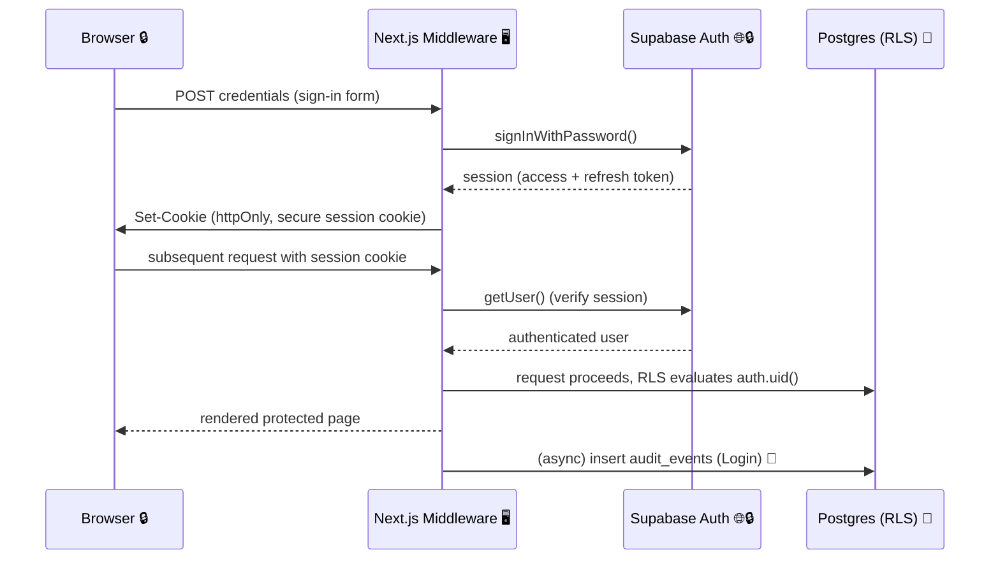
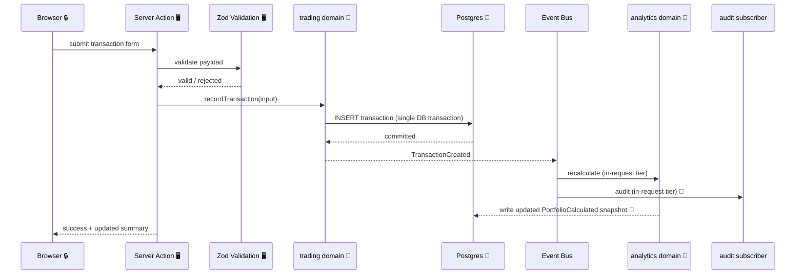
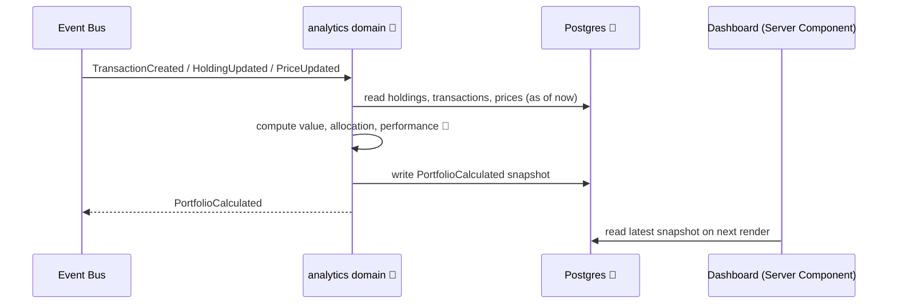
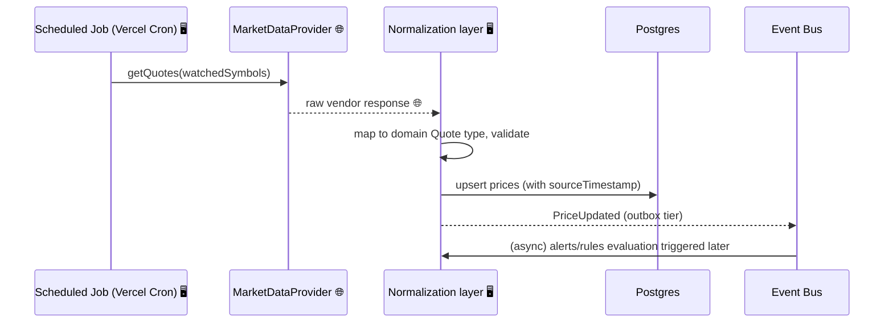
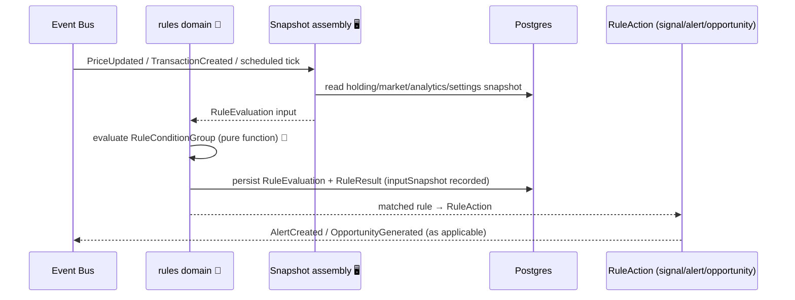
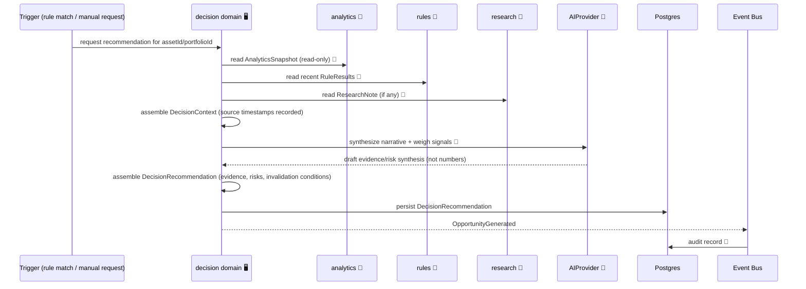
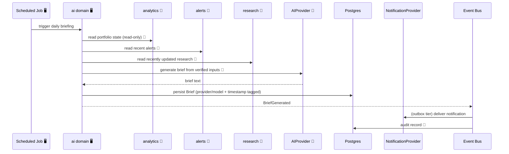
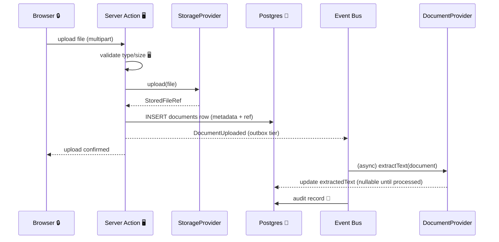
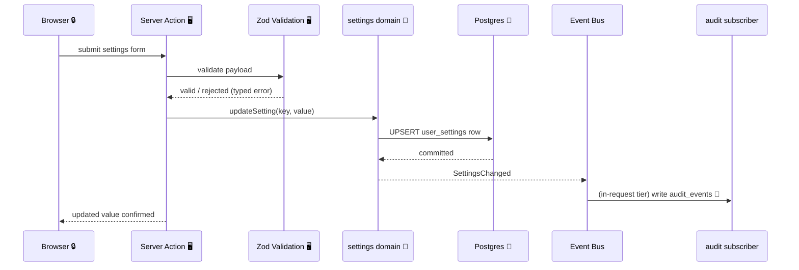

# Data Flow

## Purpose

This document traces how data moves through the system, end to end, for the key
flows the architecture supports — both the Foundation-phase flows (authentication,
settings, audit) and future-phase flows (transactions, market data, rules,
decisions, briefings, documents), shown now so later phases implement against an
already-agreed shape rather than inventing it under deadline pressure. Flows
marked **(future)** are not implemented in the Foundation milestone
(`development-roadmap.md`, `docs/implementation/foundation.md`).

## High-Level Flow

```
External Providers
      │
      ▼
Infrastructure Adapters      (provider-architecture.md implementations)
      │
      ▼
Domain Services               (domain-driven-design.md bounded contexts)
      │
      ▼
Internal Events                (event-system.md)
      │
      ▼
Analytics and Rules            (analytics, rules-engine.md)
      │
      ▼
Decision Engine                (decision-engine.md)
      │
      ▼
Alerts, Dashboard, Briefings, Reports
```

Every arrow above crosses at least one trust or process boundary; the diagrams
below make each crossing explicit rather than leaving it implied by the box
diagram.

## Legend

| Marker                       | Meaning                                                                                                                     |
| ---------------------------- | --------------------------------------------------------------------------------------------------------------------------- |
| 🔒 Trust boundary            | Data crosses from a less-trusted zone (browser, external network) into a more-trusted one (server, database), or vice versa |
| 🖥 Server-only                | Operation that must never execute in, or expose credentials to, the browser                                                 |
| 👤 User-owned data           | Data scoped to and controlled by the authenticated user, subject to RLS                                                     |
| 🌐 External provider data    | Data sourced from a third party (`provider-architecture.md`), untrusted until validated/normalized                          |
| 🤖 AI-generated content      | Output from an `AIProvider` call — always labelled, never presented as a deterministic fact                                 |
| 🧮 Deterministic calculation | Produced by domain logic over stored data, reproducible, never AI-derived                                                   |
| 📝 Audit event               | Captured via the event system per `audit-strategy.md`                                                                       |
| ⚠️ Failure handling          | What happens if this step fails                                                                                             |
| 🔁 Retry boundary            | Where retry is safe/expected vs. where it is not                                                                            |
| 🔂 Idempotency requirement   | Where a repeated call must not duplicate effects                                                                            |

---

## 1. User Authentication



- **Trust boundary:** credentials cross browser→server once, over HTTPS, and are
  never handled by application code directly — Supabase Auth owns the credential
  check (`security-principles.md`).
- **Server-only:** session verification happens in middleware/server context only;
  the browser never sees the service-role key or verifies its own session.
- **Failure handling:** invalid credentials return a generic error
  (`authentication-foundation`, `security-principles.md`) — no distinction between
  "wrong password" and "no such user" is surfaced.
- **Retry boundary:** sign-in is safely retryable by the user; Supabase Auth's own
  rate limiting bounds retry attempts (see `threat-model.md` — credential
  stuffing).
- **Idempotency:** not applicable to sign-in itself; session cookie issuance is
  naturally idempotent (a repeated valid sign-in just re-issues a session).
- **Audit limitation:** login/logout audit capture reliability depends on the
  request completing through a server-observable path — documented precisely in
  `audit-strategy.md` and `docs/implementation/foundation.md`.

---

## 2. Recording a Future Investment Transaction **(future — Phase 2)**



- **Trust boundary:** the browser never writes to `trading` tables directly — only
  through a validated Server Action.
- **Server-only:** validation and the domain write both execute server-side; the
  browser holds no direct database credential.
- **Deterministic calculation:** recalculation triggered here is pure arithmetic
  over stored data (`analytics`), never AI-derived.
- **Failure handling:** if the DB write fails, no event is published (events are
  raised only after a successful commit, per `event-system.md`) — the user sees a
  clear error, no partial state.
- **Retry boundary:** safe for the user to retry the form submission; the DB
  transaction/constraint layer prevents a genuine duplicate only if the
  operation is also made idempotent at the service layer (below).
- **Idempotency requirement:** the Server Action accepts an idempotency key
  (or relies on a client-generated draft ID) so a double-submit (e.g., a slow
  network causing a retry) does not create two transactions.

---

## 3. Recalculating a Future Portfolio **(future — Phase 4)**



- **Deterministic calculation:** the entire step is pure, reproducible arithmetic;
  no AI or external call is involved.
- **Failure handling:** a failed recalculation does not corrupt the prior
  snapshot — the write is atomic; the UI continues showing the last-known-good
  snapshot with a staleness indicator until recalculation succeeds.
- **Retry boundary:** safe to retry unconditionally — recalculation is a pure
  function of stored state, so re-running it produces the same result (naturally
  idempotent).
- **Idempotency:** inherent — recalculating twice from the same underlying data
  yields the same snapshot; no special handling required.

---

## 4. Refreshing Future Market Data **(future — Phase 3)**



- **Trust boundary:** vendor response is untrusted external data until it passes
  through normalization/validation (Zod) — malformed or out-of-range values are
  rejected, not stored.
- **External provider data:** every stored price retains `sourceTimestamp` and
  provider identity, never silently presented as "live."
- **Failure handling:** a provider error (`ProviderRateLimitError`,
  `ProviderUnavailableError` — `provider-architecture.md`) leaves prior prices in
  place with their existing (now more stale) `sourceTimestamp`; the UI/rules layer
  is expected to treat staleness explicitly (see the "Market data is stale" rule,
  `rules-engine.md`), not fail silently.
- **Retry boundary:** safe to retry the whole refresh; retries should back off on
  rate-limit errors specifically.
- **Idempotency:** an upsert keyed by `(symbol, provider)` makes repeated refreshes
  naturally idempotent — re-fetching the same quote just overwrites with the same
  or newer data.

---

## 5. Evaluating Future Investment Rules **(future — Phase 5)**



- **Deterministic calculation:** rule evaluation is a pure function of the
  recorded `inputSnapshot` — no hidden state, no live re-query mid-evaluation
  (`rules-engine.md`).
- **Failure handling:** an evaluation failure (e.g., malformed snapshot) is
  recorded as a failed `RuleEvaluation`, not silently dropped — visibility into
  "this rule did not run" matters as much as "this rule did not match."
- **Retry boundary:** safe to re-run an evaluation against the same
  `inputSnapshot`; unsafe to assume re-running against a _new_ snapshot reproduces
  the old result (expected — inputs changed).
- **Idempotency:** each `RuleEvaluation` is a new record — evaluation itself is not
  meant to be deduplicated, but the `RuleAction` it produces (e.g., an alert)
  should be deduplicated downstream so the same condition firing on consecutive
  ticks doesn't spam duplicate alerts.

---

## 6. Producing a Future Decision Recommendation **(future — Phase 6)**



- **Trust boundary:** the `AIProvider` call receives only the already-computed,
  read-only `AnalyticsSnapshot` — it cannot originate or alter a financial figure
  (`decision-engine.md`'s explicit AI limit).
- **AI-generated content:** any AI-authored text is labelled with provider/model
  and timestamp and stored as such; it is never merged into `analyticsSnapshot`
  or presented as a deterministic figure.
- **Deterministic calculation:** all portfolio/holding figures referenced in the
  recommendation originate from `analytics`, assembled before the AI call, never
  after or from it.
- **Failure handling:** if the AI call fails, a recommendation can still be
  produced from rules/analytics alone (`conclusionSource: "deterministic_rules"`)
  — AI unavailability degrades richness, not correctness, of the recommendation.
- **Retry boundary:** the AI synthesis sub-step is safely retryable in isolation;
  retrying does not re-trigger the DB writes already committed for the
  `DecisionContext`.
- **Idempotency:** a recommendation request for the same trigger event should not
  produce duplicate `DecisionRecommendation` rows — the triggering event's
  correlation ID is used as a deduplication key.

---

## 7. Generating a Future Daily Briefing **(future — Phase 10)**



- **AI-generated content:** the entire brief body is AI output and is displayed
  with a clear provider/model/timestamp label (`product-specification.md`, AI
  Briefing screen) — never presented as if server-computed fact.
- **Deterministic calculation:** the _inputs_ to the brief (portfolio value,
  alerts) are deterministic and computed before the AI call, exactly as in flow 6.
- **Failure handling:** a failed generation is retried on the next scheduled run;
  no partial/garbled brief is persisted (the write only happens after a complete,
  validated AI response).
- **Retry boundary:** safe to retry the whole generation; not safe to retry only
  the persistence step without the generation (a stale AI response should not be
  saved against a new trigger).
- **Idempotency:** one brief per scheduled trigger per user, enforced by a unique
  constraint on `(userId, triggerDate)` so a duplicate cron invocation does not
  produce two briefs for the same day.

---

## 8. Uploading and Processing a Future Research Document **(future — Phase 9)**



- **Trust boundary:** an uploaded file is untrusted content until validated
  (type/size) and stored via `StorageProvider` — never executed, never rendered
  as HTML (`threat-model.md` — malicious document uploads).
- **User-owned data:** documents are RLS-scoped to their owner (and later,
  household membership) exactly as every other user-owned table.
- **Failure handling:** if extraction (`DocumentProvider`) fails, the document
  remains stored and usable with `extractedText: null` — processing failure never
  blocks the primary upload action, matching the same fail-open-but-visible
  principle used for audit writes.
- **Retry boundary:** upload itself is not silently retried (a failed upload
  surfaces to the user to retry deliberately, avoiding partial/duplicate large
  file writes); text extraction in the outbox tier is safely retried by the
  polling job.
- **Idempotency:** extraction is idempotent by design — re-running it against the
  same stored file overwrites `extractedText` with the same result.

---

## 9. Changing Application Settings **(Foundation)**



- **Trust boundary:** settings values are validated server-side against the
  schema in `settings-engine.md` — the client never writes directly to
  `user_settings`.
- **Server-only:** the validation and write both execute in a Server Action; no
  direct client Supabase write path exists for this table.
- **Audit event:** every settings change is audited with before/after values,
  excluding any setting classified as sensitive (none currently are, per
  `data-classification.md` — provider _selection_ is stored, never a credential).
- **Failure handling:** if the audit write fails, the settings change still
  succeeds (per `audit-strategy.md`'s fail-open-but-logged principle) — the
  audit failure itself is logged for operator visibility.
- **Idempotency:** an UPSERT keyed by `(userId, settingKey)` makes repeated
  identical submissions naturally idempotent.

---

## 10. Recording an Audit Event **(Foundation)**

```mermaid
sequenceDiagram
    participant SVC as Any domain service
    participant EV as Event Bus
    participant AH as AuditEventHandler
    participant DB as Postgres (append-only) 📝

    SVC->>DB: commit primary write (e.g., settings, transaction)
    SVC-->>EV: publish domain event (post-commit)
    EV->>AH: dispatch to audit subscriber
    AH->>AH: sanitize metadata (strip secrets/tokens/documents)
    AH->>DB: INSERT audit_events (append-only; UPDATE/DELETE denied by policy)
    alt audit write fails
        AH->>AH: log failure locally (structured log)
        Note over SVC: primary action already succeeded — not rolled back
    end
```

- **Trust boundary:** the audit subscriber runs server-side only; nothing about
  audit capture is ever exposed to or triggerable directly by the browser.
- **Audit event:** this diagram _is_ the general mechanism every other flow's 📝
  annotations refer to — one handler, reused everywhere, per `audit-strategy.md`.
- **Failure handling:** explicitly fail-open for the primary action — an audit
  write failure is logged (structured, no sensitive payload) but never reverses
  or blocks the user's original action, per your requirement in the Foundation
  brief. This is a deliberate trade-off: availability of the primary action over
  guaranteed-synchronous audit capture; the residual risk (a missed audit record
  under audit-subsystem failure) is accepted and tracked in `threat-model.md`.
- **Idempotency:** each event carries a `correlationId`; the audit handler is
  written to be safe under at-least-once delivery (outbox tier events may be
  redelivered) — inserting the same audit record twice is a known, accepted
  possibility for outbox-tier events and is not treated as data corruption (the
  audit log is a record of "this was attempted/happened," not a balance that must
  reconcile to a single row).

---

## Cross-Cutting Notes

- **Server-only enforcement:** every 🖥-marked step is enforced structurally
  (Server Actions, Route Handlers, middleware) — never by client-side convention
  alone. See `security-foundation` (`docs/implementation/foundation.md`) for what
  is verified vs. planned in the current milestone.
- **RLS is the final authorization boundary** on every 👤-marked data access,
  regardless of what the application code intends to do — consistent with
  `security-principles.md`.
- **AI is never on the critical path for a financial figure.** Every flow above
  that touches AI (6, 7) assembles deterministic data first and treats AI output
  as additive narrative, never as a source the flow depends on for correctness.
